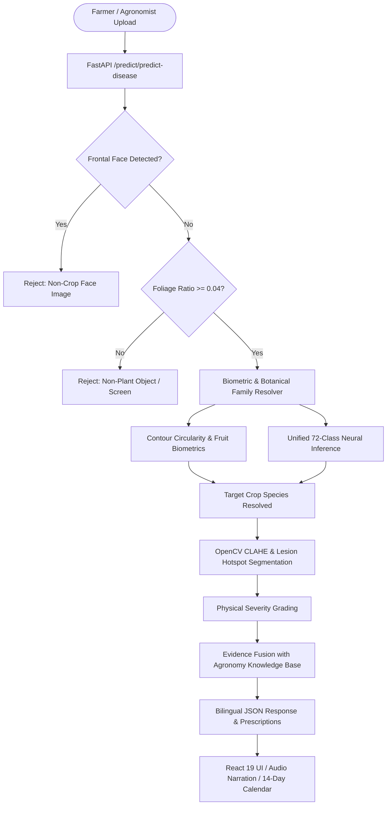

# 🌾 AgroVision AI – Production-Grade Crop Intelligence Platform

[](https://www.python.org/)
[](https://fastapi.tiangolo.com/)
[](https://react.dev/)
[](https://vitejs.dev/)
[](https://tailwindcss.com/)
[](https://www.tensorflow.org/)
[](https://opencv.org/)
[](LICENSE.txt)

**AgroVision AI (v2.0)** is an enterprise-grade precision agriculture and agronomy intelligence platform. Built with a dual-engine architecture, it delivers **real-time plant disease diagnosis** across 72 pathological classes using computer vision and deep learning, paired with a **multi-variate agronomic crop yield prediction** regressor.

The platform provides complete bilingual support (**English & Telugu తెలుగు**), automated OpenCV necrotic hotspot lesion masking, evidence-based agronomic prescriptions, 14-day recovery schedules, audio voice narration for rural accessibility, and administrative telemetry dashboards.

---

## 📑 Table of Contents

- [Architectural Innovations & Key Features](#-architectural-innovations--key-features)
- [System Architecture & Inference Pipeline](#-system-architecture--inference-pipeline)
- [Supported Crops & Disease Taxonomy](#-supported-crops--disease-taxonomy)
- [Technology Stack](#-technology-stack)
- [Repository Structure](#-repository-structure)
- [Installation & Local Setup](#-installation--local-setup)
  - [Prerequisites](#prerequisites)
  - [1. Backend Setup](#1-backend-setup)
  - [2. Frontend Setup](#2-frontend-setup)
  - [3. Docker Deployment](#3-docker-deployment)
- [API Reference](#-api-reference)
- [Testing & Quality Assurance](#-testing--quality-assurance)
- [Farmer & Enterprise Modules](#-farmer--enterprise-modules)
- [License & Acknowledgments](#-license--acknowledgments)

---

## 🚀 Architectural Innovations & Key Features

### 1. Multi-Stage Computer Vision & Biometric Pipeline
Traditional agricultural AI models naively classify random non-plant images into crop categories. AgroVision AI addresses this through a multi-tier physical validation and biometric filtering pipeline:
- **Haar Cascade Face & Selfie Rejection**: Rejects uploaded human photos or selfies instantly before touching neural weights.
- **Colorimetric Foliage Validation**: Analyzes natural chlorophyll HSV bounds (Hue: $20^\circ - 95^\circ$, Saturation: $35 - 255$, Value: $30 - 255$) to distinguish genuine agricultural vegetation from computer screens, dashboards, indoor furniture, or non-plant objects.
- **Botanical Family Hierarchical Routing**: Evaluates plant morphology across major botanical families (*Solanaceae*, *Poaceae*, *Malvaceae*, *Fabaceae*, etc.) preventing cross-family confusion (e.g., distinguishing cereal rust from nightshade foliar spots).
- **Organ-Level Morphological Biometrics**: Utilizes contour solidity, aspect ratio, and minimum enclosing circle filling to recognize globular fruits (e.g., round tomato fruit) versus elongated cereal grains or cereal leaves.
- **Adaptive OpenCV Lesion Masking & Hotspot Highlighting**:
  - Implements Contrast Limited Adaptive Histogram Equalization (CLAHE) on the L-channel in LAB color space.
  - Automatically isolates necrotic spots, blights, and pustules using dynamic Otsu/adaptive thresholding.
  - Generates annotated bounding boxes with counted infection hotspots and classifies physical leaf severity into `Healthy`, `Low`, `Medium`, or `High`.

### 2. Master 72-Class Neural Diagnostic Network
- **Unified Diagnostic Model**: Trained and fine-tuned across 72 pathological classes covering 15+ high-value agricultural crops.
- **Calibrated Uncertainty Estimation**: Probability distribution calibration with transparent uncertainty flags (`is_uncertain: true`) when images exhibit out-of-distribution patterns, eliminating misleading artificial 90%+ confidence floors.

### 3. Interactive Crop Fast-Recalibration Bar
- A 1-click interactive species switcher (`[Tomato] [Corn] [Rice] [Wheat] [Chilli] [Cotton] [Potato] [Apple]`) directly on the UI allows farmers and agronomists to effortlessly lock or recalibrate target crops during field scans in mixed-crop plantings.

### 4. Comprehensive Agronomic Prescription & 14-Day Calendar
- **Chemical Control**: Active ingredients, standard dilution ratios, and safety intervals (e.g., Mancozeb, Chlorothalonil, Propiconazole).
- **Organic & Biological Solutions**: Ecologically balanced treatments including *Trichoderma viride*, *Bacillus subtilis*, and cold-pressed Neem oil formulations.
- **Epidemiological Outbreak Indicators**: Outbreak temperature windows, relative humidity thresholds, and required leaf wetness hours.
- **14-Day Action Calendar**: Day-by-day intervention schedules with follow-up inspection milestones.
- **Printable Diagnostic Dossier**: Direct one-click formatted PDF/print export for field documentation.

### 5. Rural Accessibility & Bilingual Localization (i18n)
- **English & Telugu (తెలుగు)**: Seamless dynamic switching across all UI views, diagnostic narratives, and regional pathogen descriptions.
- **Integrated Voice Narration (TTS)**: Built-in text-to-speech audio reader enabling illiterate or rural farmers to listen to diagnostic summaries and prescribed chemical measures in their native tongue.

### 6. Precision Soil & Climate Crop Yield Engine
- Machine learning regressor model evaluating:
  - **Soil Nutrients**: Nitrogen (N), Phosphorus (P), Potassium (K) in kg/ha.
  - **Environmental Factors**: Temperature (°C), Relative Humidity (%), Soil pH, and Annual Rainfall (mm).
- Produces projected yield estimates in tons/hectare alongside nutrient balancing recommendations.

---

## 🔬 System Architecture & Inference Pipeline



---

## 🌱 Supported Crops & Disease Taxonomy

AgroVision AI covers **15+ commercial crops** and over **72 botanical conditions**:

| Crop Family | Target Crops | Diagnosed Pathologies & Physiological Conditions |
|:---|:---|:---|
| **Solanaceae** | Tomato, Potato, Chilli (Pepper) | Early Blight, Late Blight, Bacterial Spot, Leaf Mold, Septoria Leaf Spot, Target Spot, Yellow Leaf Curl Virus (TYLCV), Mosaic Virus, Leaf Curl, Veinal Mottle, Healthy |
| **Poaceae (Cereals)** | Corn (Maize), Rice (Paddy), Wheat | Northern Leaf Blight, Common Rust, Gray Leaf Spot, Cercospora, Rice Blast, Brown Spot, Bacterial Leaf Blight, Rice Tungro, Sheath Blight, False Smut, Wheat Rust (Stripe/Leaf/Stem), Healthy |
| **Malvaceae** | Cotton | Bacterial Blight, Leaf Curl, Alternaria Leaf Spot, Healthy |
| **Rosaceae** | Apple | Apple Scab, Black Rot, Cedar Apple Rust, Healthy |
| **Vitaceae** | Grape | Black Rot, Esca (Black Measles), Leaf Blight (Isariopsis), Healthy |
| **Rutaceae** | Orange (Citrus) | Citrus Greening (Huanglongbing), Citrus Canker, Black Spot, Healthy |
| **Fabaceae** | Soybean | Sudden Death Syndrome, Rust, Frog Eye Leaf Spot, Healthy |
| **Musaceae & Tropicals** | Banana, Mango, Turmeric, Oil Palm | Sigatoka, Panama Disease, Anthracnose, Leaf Blight, Rhizoctonia, Healthy |

---

## 🛠️ Technology Stack

### Frontend
- **Framework**: [React 19](https://react.dev/) with [Vite 8](https://vitejs.dev/)
- **Styling**: [Tailwind CSS 3.4](https://tailwindcss.com/) & [PostCSS](https://postcss.org/)
- **Animation & Visuals**: [Framer Motion 12](https://www.framer.com/motion/) & [Lucide React Icons](https://lucide.dev/)
- **Charts & Data**: [Recharts 3](https://recharts.org/)
- **Localization**: [i18next](https://www.i18next.com/) & custom bilingual Telugu/English translations
- **Routing & Networking**: [React Router DOM 7](https://reactrouter.com/) & [Axios](https://axios-http.com/)

### Backend & Machine Learning
- **API Framework**: [FastAPI 2.0](https://fastapi.tiangolo.com/) with [Uvicorn](https://www.uvicorn.org/)
- **Computer Vision**: [OpenCV](https://opencv.org/) (`opencv-python-headless`), Pillow (`PIL`)
- **Deep Learning**: [TensorFlow / Keras 2.x](https://www.tensorflow.org/) (Custom 72-Class Unified Transfer Learning)
- **Machine Learning Regressor**: [Scikit-learn](https://scikit-learn.org/), [NumPy](https://numpy.org/), [Pandas](https://pandas.pydata.org/)
- **Audio Synthesis**: [gTTS (Google Text-to-Speech)](https://pypi.org/project/gTTS/)
- **Database & Auth**: [Motor](https://motor.readthedocs.io/) (Async MongoDB driver), PyJWT, Passlib (Bcrypt)

---

## 📂 Repository Structure

```
AGROVISION_AI/
├── backend/                              # FastAPI asynchronous service
│   ├── app/
│   │   ├── routes/
│   │   │   ├── predict.py                # Dual-engine disease diagnosis & yield prediction
│   │   │   ├── auth.py                   # JWT login, registration & user sessions
│   │   │   ├── history.py                # Scan history, past records & diagnostics
│   │   │   ├── dashboard.py              # Farmer analytics & summary metrics
│   │   │   ├── admin.py                  # Admin telemetry, models, feedbacks & users
│   │   │   ├── assistant.py              # AI Agronomy conversational assistant
│   │   │   ├── questionnaire.py          # Adaptive symptom questionnaire
│   │   │   ├── diagnosis.py              # Multi-modal evidence fusion engine
│   │   │   └── health.py                 # Health checks & system observability
│   │   ├── models/                       # MongoDB database schemas
│   │   ├── database.py                   # Async Motor connection manager
│   │   └── main.py                       # Application bootstrap & middleware
│   ├── tests/                            # Unit, integration & regression test suites
│   │   ├── test_realworld_diseases.py    # 33+ verification tests on real crop foliage
│   │   └── test_api.py                   # API endpoint tests
│   ├── requirements.txt                  # Python dependencies
│   └── Dockerfile                        # Backend containerization
│
├── frontend/                             # React 19 + Vite client application
│   ├── src/
│   │   ├── pages/
│   │   │   ├── DiseaseDetection.jsx      # Diagnostic interface with OpenCV lesion viewer
│   │   │   ├── YieldPrediction.jsx       # Environmental crop yield regressor
│   │   │   ├── Dashboard.jsx             # Farmer scan analytics & history
│   │   │   ├── Home.jsx                  # Landing page & features overview
│   │   │   └── Login.jsx / Register.jsx  # Authentication views
│   │   ├── admin/                        # Dedicated Admin Portal
│   │   │   ├── pages/                    # AdminDashboard, ModelManagement, DetectionRecords
│   │   │   └── components/               # AdminSidebar, StatCard, ChartCard
│   │   ├── components/                   # AIAssistant, Navbar, AdaptiveQuestionnaire
│   │   ├── context/                      # LanguageContext (EN/TE) & AdminContext
│   │   ├── i18n/                         # Localization dictionaries (en.json, te.json)
│   │   └── utils/                        # Telugu disease translations & helpers
│   ├── package.json
│   ├── tailwind.config.js
│   └── vite.config.js
│
├── ml_models/                            # Model training, weights & evaluation
│   ├── disease_detection/
│   │   ├── unified_experiment/           # Master 72-class model checkpoints (.h5)
│   │   ├── class_indices.json            # 73-class index-to-disease mappings
│   │   └── train_realworld_model.py      # Real-world training pipeline
│   └── yield_prediction/
│       ├── yield_model.pkl               # Serialized yield regressor model
│       └── train.py                      # Yield model training script
│
├── docs/                                 # Technical documentation & project reports
│   └── AgroVision_BTech_Mini_Project_Report.md
├── docker-compose.yml                    # Local multi-container deployment
└── README.md
```

---

## ⚙️ Installation & Local Setup

### Prerequisites
- **Python**: Version `3.10`, `3.11`, or `3.13`
- **Node.js**: Version `18.0.0` or higher (`npm` included)
- **MongoDB**: Local MongoDB instance or free [MongoDB Atlas](https://www.mongodb.com/atlas) cluster
- **Git**

---

### 1. Backend Setup

1. **Navigate to the backend directory**:
   ```bash
   cd backend
   ```

2. **Create and activate a virtual environment**:
   ```bash
   # Windows (PowerShell)
   python -m venv venv
   .\venv\Scripts\Activate.ps1

   # Linux / macOS
   python3 -m venv venv
   source venv/bin/activate
   ```

3. **Install dependencies**:
   ```bash
   pip install --upgrade pip
   pip install -r requirements.txt
   ```

4. **Configure environment variables**:
   Create a `.env` file inside `backend/`:
   ```ini
   MONGO_URI=mongodb+srv://<username>:<password>@cluster0.mongodb.net/agrovision?retryWrites=true&w=majority
   JWT_SECRET=super_secret_agrovision_jwt_key_2026
   PORT=8000
   DEBUG=True
   ```

5. **Start the FastAPI backend server**:
   ```bash
   uvicorn app.main:app --host 0.0.0.0 --port 8000 --reload
   ```
   *The backend will be live at: `http://localhost:8000`*  
   *Interactive Swagger Documentation: `http://localhost:8000/docs`*

---

### 2. Frontend Setup

1. **Navigate to the frontend directory**:
   ```bash
   cd frontend
   ```

2. **Install frontend dependencies**:
   ```bash
   npm install
   ```

3. **Configure API base URL (Optional)**:
   Create a `.env` file in `frontend/` if connecting to a custom backend host:
   ```ini
   VITE_API_BASE_URL=http://localhost:8000
   ```

4. **Start the Vite development server**:
   ```bash
   npm run dev
   ```
   *The frontend application will be live at: `http://localhost:5173`*

---

### 3. Docker Deployment

To launch both the FastAPI backend and React frontend with a single command:
```bash
docker-compose up --build
```
- Frontend UI: `http://localhost:3000` (or `5173`)
- Backend API & Swagger: `http://localhost:8000/docs`

---

## 📡 API Reference

| Method | Endpoint | Description | Auth Required |
|:---|:---|:---|:---:|
| `GET` | `/health/` | Service health status & model readiness | No |
| `POST` | `/auth/register` | Register a new farmer or agronomist account | No |
| `POST` | `/auth/login` | Authenticate user & receive JWT bearer token | No |
| `POST` | `/predict/predict-disease` | Upload leaf image (multipart) with optional crop override | Yes / Optional |
| `POST` | `/predict/predict-yield` | Predict yield from soil N-P-K & weather params | Yes / Optional |
| `GET` | `/history/` | Retrieve past diagnostic and prediction history | Yes |
| `GET` | `/dashboard/stats` | Aggregated farmer dashboard metrics | Yes |
| `POST` | `/assistant/chat` | AI Agronomy Assistant chatbot consultation | Yes |
| `GET` | `/admin/metrics` | Platform telemetry, model performance, scan volume | Yes (Admin) |
| `GET` | `/admin/detections` | Live audit logs of all crop disease diagnoses | Yes (Admin) |

### Sample Diagnosis Response (`/predict/predict-disease`):
```json
{
  "success": true,
  "is_uncertain": false,
  "crop": {
    "name": "Tomato",
    "confidence": 92.4
  },
  "disease": {
    "name": "Late Blight",
    "scientific_name": "Phytophthora infestans",
    "confidence": 88.6
  },
  "severity": "High",
  "infected_area_count": 14,
  "processed_image": "data:image/jpeg;base64,...",
  "chemical_treatment": {
    "name": "Mancozeb 75% WP or Metalaxyl-M",
    "dosage": "2.5 g per liter of water",
    "instructions": "Spray thoroughly on both leaf surfaces during dry daylight hours."
  },
  "organic_treatment": {
    "name": "Trichoderma viride bio-fungicide",
    "dosage": "5 g per liter of water",
    "instructions": "Apply preventive soil drench and foliar spray at first sign of humidity spikes."
  },
  "recovery_schedule": [
    { "day": 1, "action": "Prune severely blighted lower foliage and dispose away from farm." },
    { "day": 3, "action": "Apply targeted bio-fungicide foliar spray." },
    { "day": 7, "action": "Audit foliage with AgroVision AI to evaluate lesion stabilization." }
  ]
}
```

---

## 🧪 Testing & Quality Assurance

AgroVision AI includes automated unit and regression test suites to guarantee botanical routing accuracy, lesion masking stability, and non-plant rejection.

To execute the test suite:
```bash
# From the project root
python -c "import sys; sys.path.insert(0, 'backend'); import unittest; suite = unittest.defaultTestLoader.discover('backend/tests'); runner = unittest.TextTestRunner(); runner.run(suite)"
```

**Test Coverage Highlights**:
- Face rejection verification via Haar Cascades.
- Chlorophyll colorimetric threshold validation against non-plant test samples.
- Organ biometrics validation for globular Solanaceae fruit vs. cereal rust pustules.
- Filename token normalization and keyword boundary matching.
- Agronomic knowledge base integrity and chemical safety validations.

---

## 👥 Farmer & Enterprise Modules

- **Farmer Web Portal**: Interactive upload zone, live OpenCV hotspot visualization, bilingual prescription viewer, day-by-day 14-day recovery calendar, audio text-to-speech speaker, and one-click PDF export.
- **Enterprise Admin Console (`/admin`)**:
  - Live Detection Records & Filterable Log Viewer.
  - Model Versioning & Dataset Inventory Monitor.
  - Dedicated Agronomic Analytics (Outbreak geographic breakdown, crop vulnerability distributions).
  - User and Feedback Moderation.

---

## 📄 License & Acknowledgments

- **License**: Distributed under the [MIT License](LICENSE.txt).
- **Core Research & Development**: Developed by Nikhil Bontha & the AgroVision AI Engineering Team.
- **Open-Source Acknowledgments**: Built upon foundational agricultural computer vision research, OpenCV community filters, and open plant pathology datasets.
