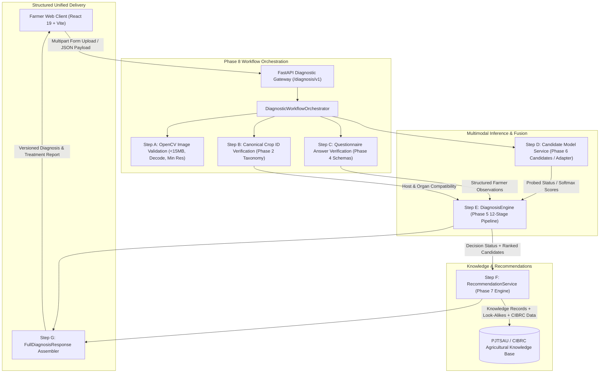

# AgroVision AI 2.0 — Integration Architecture & System Specification

## 1. Executive Overview

This document specifies the end-to-end full-stack integration architecture for **AgroVision AI 2.0 (Phase 8)**. The architecture integrates the verified components developed in Phases 2 through 7 into a coherent, verifiable, and transparent crop disease diagnostic pipeline.

The system replaces single-model, forced-classification inference with a multi-source evidence fusion pipeline that combines visual features, farmer-reported symptom telemetry, canonical crop taxonomy constraints, and authoritative agricultural knowledge.

---

## 2. Architecture & Service Boundary Topology

---

## 3. Workflow Steps Detail (Steps A through G)

### Step A — Image Upload & Integrity Validation
- **Location:** [`backend/app/services/diagnostic_workflow_orchestrator.py`](file:///e:/tekworks_projects/crop/backend/app/services/diagnostic_workflow_orchestrator.py) & [`backend/app/routes/diagnosis.py`](file:///e:/tekworks_projects/crop/backend/app/routes/diagnosis.py)
- **File Validation:** Rejects empty (0-byte) files or uploads exceeding 15MB with HTTP 400.
- **Decoding:** Uses OpenCV `imdecode` with non-zero resolution check ($\ge 16 \times 16$ px).
- **Safety Principle:** Corrupt, invalid, or unreadable binaries are caught at the gateway boundary with actionable farmer guidance rather than crashing the Python process. Simple color-based masks are never treated as verified disease segmentation.

### Step B — Crop Confirmation & Canonical ID Gating
- **Location:** [`docs/agrovision_v2/phase2/crop_registry.json`](file:///e:/tekworks_projects/crop/docs/agrovision_v2/phase2/crop_registry.json)
- **Validation:** Verifies farmer-selected `selected_crop_id` against the validated canonical registry.
- **Independence:** Preserves the distinction between farmer selection and model-derived crop predictions. Disagreements trigger `crop_mismatch` rather than silently forcing a match.

### Step C — Adaptive Symptom Questionnaire
- **Location:** [`backend/app/schemas/questionnaire_schema.py`](file:///e:/tekworks_projects/crop/backend/app/schemas/questionnaire_schema.py)
- **Collection:** Captures affected organ, onset duration, spread rate, phenological growth stage, microclimate conditions, visible pests, and prior treatments.
- **Answer Retention:** Full navigation backwards and forwards preserves form answers in state. Unknown answers (`sym_unsure`) are permitted and propagate uncertainty downstream.

### Step D — Candidate Model Interface & Honest Failure Handling
- **Location:** [`backend/app/services/diagnosis_engine.py`](file:///e:/tekworks_projects/crop/backend/app/services/diagnosis_engine.py)
- **Status Probing:** Probes deep learning runtime dependencies on startup. If native host restrictions (e.g. Windows WDAC) prevent loading `.pyd` libraries, the system immediately records `model_unavailable` without crashing.
- **Honesty Invariant:** When model inference fails or is offline, the system **never** substitutes a random prediction, hardcoded diagnosis, or fabricated confidence score.

### Step E — Evidence-Based Diagnosis Engine (12 Stages)
- **Location:** [`backend/app/services/diagnosis_engine.py`](file:///e:/tekworks_projects/crop/backend/app/services/diagnosis_engine.py)
- **Evidence Fusion:** Synthesizes raw model scores, crop compatibility, organ matrices, and farmer symptom vectors.
- **Traceability:** Emits an `evidence_ledger` documenting supporting evidence, conflicting evidence, and contradictions for every candidate diagnosis.
- **Abstention Support:** Explicitly emits 10 cataloged decision statuses, including `diagnosis_supported`, `multiple_candidates`, `needs_more_information`, `organ_mismatch`, `crop_mismatch`, `unsupported_crop`, and `model_unavailable`.

### Step F — Agricultural Knowledge & Recommendation Service
- **Location:** [`backend/app/services/recommendation_service.py`](file:///e:/tekworks_projects/crop/backend/app/services/recommendation_service.py)
- **Status Gating:** Strictly inspects `decision_status`. If the status is uncertain or unsupported, `guidance_permitted` is set to `False` and chemical recommendations are withheld (`verified_chemical_treatments = []`).
- **Traceability:** Returns authoritative citations (PJTSAU Vyavasaya Panchangam, ANGRAU, ICAR, CIBRC) and statutory disclaimers.

### Step G — Structured Unified Diagnostic Report
- **Response Schema:** [`FullDiagnosisResponse`](file:///e:/tekworks_projects/crop/backend/app/schemas/diagnosis_schema.py)
- **Sanitization:** Internal stack traces, server paths, and credentials are never exposed to the frontend.
- **Version Tracking:** Full diagnostic payload includes `diagnosis_engine_version`, `model_version`, `taxonomy_version`, and `questionnaire_version`.

---

## 4. API Endpoints Contract

| Endpoint | Method | Payload Type | Consumer | Purpose |
| :--- | :--- | :--- | :--- | :--- |
| `/diagnosis/v1/full-diagnosis-upload` | `POST` | `multipart/form-data` | `AdaptiveQuestionnaire.jsx` | Full end-to-end diagnosis with file upload |
| `/diagnosis/v1/full-diagnosis` | `POST` | `application/json` | ML Integration Services | Full diagnosis with mock/base64 payloads |
| `/diagnosis/v1/diagnose` | `POST` | `application/json` | Backend Tests / Services | Isolated multimodal diagnosis engine execution |
| `/diagnosis/v1/recommend` | `POST` | `application/json` | Agronomic Advisory Service | Standalone recommendation lookup |
| `/diagnosis/v1/knowledge/{id}` | `GET` | N/A | Diagnostic Modals | Specific crop disease knowledge record |
| `/diagnosis/v1/statuses` | `GET` | N/A | Frontend UI Status Badges | Decision status catalog retrieval |
| `/predict/predict-yield` | `POST` | `application/json` | `YieldPrediction.jsx` | Preserved production yield forecasting |
| `/assistant/chat` | `POST` | `application/json` | Chatbot Widget | Preserved AI farmer assistant |

---

## 5. Security, Observability, and Data Privacy

1. **Request Correlation:** Every workflow execution generates a unique request correlation ID (`cid` e.g., `req_a1b2c3d4e5f6`) logged across all stages.
2. **Privacy & Zero Storage:** Image binaries are parsed and processed purely in-memory; raw image bytes and personal farmer notes are never stored to unencrypted persistent disks.
3. **Defense-in-Depth Validation:** All endpoints validate schemas via Pydantic v2 models, enforcing strict field types and size limits.
