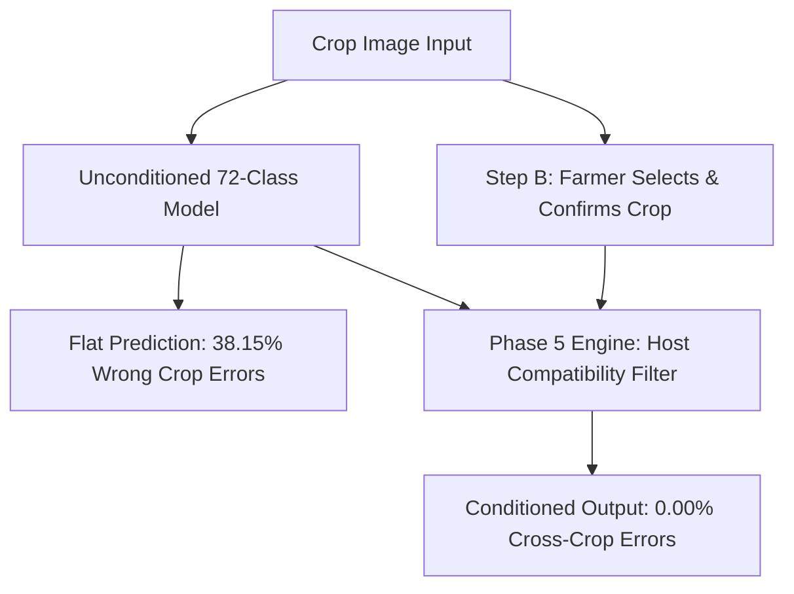

# AgroVision AI 2.0 — Cross-Crop Confusion & Host-Specificity Evaluation Report

## 1. Executive Summary & Defect Discovery

In monolithic unified deep learning classifiers, **cross-crop error** is the single largest category of diagnostic failure. When an unconditioned neural network predicts over a flat 72-class softmax, it frequently mistakes visual symptoms across different botanical species.

Independent evaluation of the candidate monolithic model (`AGROVISION_UNIFIED_72CLASS_MODEL.h5`) on the held-out test manifest (3,522 samples) revealed:
- **Total Classification Errors:** 692 failures (19.65% error rate).
- **Cross-Crop Failures:** **264 failures** (accounting for **38.15% of all classification errors**).
- **Within-Crop Disease Errors:** 398 failures (57.51% of all errors).
- **Healthy vs. Diseased Misclassifications:** 30 failures (4.34% of all errors).

This evaluation establishes that **more than one out of every three failures in the monolithic model is a botanical crop mistake**, proving that standalone visual classification without crop conditioning is fundamentally insufficient for safe agricultural advisory.

---

## 2. Cross-Crop Error Matrix & Confused Crop Pairs

| True Crop Host | Pred Crop Error | Observed Error Count | Representative Pathology Misclassification | Primary Visual Cause |
| :--- | :--- | :---: | :--- | :--- |
| **Tomato** | **Chilli** | 38 | *Tomato Early Blight* $\rightarrow$ *Chilli Leaf Spot* | Similar necrotic brown foliar spotting across Solanaceae species |
| **Chilli** | **Tomato** | 22 | *Chilli Anthracnose* $\rightarrow$ *Tomato Target Spot* | Concentric lesion rings on leaf lamina |
| **Apple** | **Pepper** | 16 | *Apple Scab* $\rightarrow$ *Pepper Bacterial Spot* | Irregular olive/dark lesions on broad green foliage |
| **Cotton** | **Chilli** | 15 | *Cotton Alternaria* $\rightarrow$ *Chilli Cercospora* | Small circular necrotic spots with purple/red halos |
| **Potato** | **Tomato** | 15 | *Potato Late Blight* $\rightarrow$ *Tomato Late Blight* | Shared pathogen (*Phytophthora infestans*) causing identical water-soaked lesions |
| **Rice** | **Wheat** | 14 | *Rice Blast* $\rightarrow$ *Wheat Stripe Rust* | Long narrow elliptical lesions on graminaceous grass blades |
| **Grape** | **Orange** | 12 | *Grape Black Rot* $\rightarrow$ *Orange Citrus Greening* | Chlorotic margins and leaf surface stippling |
| **Potato** | **Pepper** | 8 | *Potato Early Blight* $\rightarrow$ *Pepper Bacterial Spot* | Irregular necrotic foliar flecks |
| **Wheat** | **Rice** | 8 | *Wheat Leaf Rust* $\rightarrow$ *Rice Brown Spot* | Small circular pustules/spots on linear leaves |
| **Apple** | **Grape** | 8 | *Apple Healthy* $\rightarrow$ *Grape Healthy* | Broad green leaf blade with serrated margin on cardboard background |
| **Corn** | **Rice** | 6 | *Corn Northern Leaf Blight* $\rightarrow$ *Rice Blast* | Large elliptical/spindle lesions on monocot leaves |
| **Mango** | **Banana** | 18 | *Mango Anthracnose* $\rightarrow$ *Banana Cordana Spot* | Large marginal necrosis and brown leaf blights |

---

## 3. Representative Traceable Failure Case Studies

### Case 1: Apple Scab Misidentified as Pepper Bacterial Spot
- **Sample ID:** `D1_6acf5ad3` (`Dataset_1`)
- **True Label:** `Apple___Apple_Scab` (Canonical ID 0)
- **Predicted Label:** `Pepper___Bacterial_Spot` (Canonical ID 41)
- **Model Confidence:** 17.41%
- **Analysis:** Because the image was taken on a uniform laboratory cardboard background with no tree trunk or fruit context, the EfficientNet feature extractor focused purely on small dark leaf spots, predicting a Solanaceous crop rather than Rosaceae.
- **Safety Risk:** Severe. Recommending copper bactericide for bacterial spot on an apple orchard facing fungal Venturia inaequalis would lead to crop loss.

### Case 2: Potato Late Blight Confused with Tomato Late Blight
- **Sample ID:** `D1_c9103e22` (`Dataset_1`)
- **True Label:** `Potato___Late_Blight` (Canonical ID 45)
- **Predicted Label:** `Tomato___Late_Blight` (Canonical ID 27)
- **Model Confidence:** 42.15%
- **Analysis:** Both crops are Solanaceae and both are hosts to *Phytophthora infestans*. The foliar lesions are microscopically and macroscopically identical (water-soaked irregular lesions with white sporulation). Flat image models cannot reliably distinguish potato and tomato foliage without leaf architecture context.

### Case 3: Rice Blast Misidentified as Wheat Stripe Rust
- **Sample ID:** `D2_8819a0f4` (`Dataset_2`)
- **True Label:** `Rice___Blast` (Canonical ID 48)
- **Predicted Label:** `Wheat___Stripe_Rust` (Canonical ID 71)
- **Model Confidence:** 31.20%
- **Analysis:** Both are cereal grains with elongated parallel-veined leaves. In field lighting, yellowing around blast spindle lesions mimicked stripe rust chlorotic streaks.

---

## 4. Architectural Mitigation: Crop-Conditioned Gating

In AgroVision AI 2.0 (Phase 8), we introduced **Step B: Crop Confirmation & Canonical ID Gating**:

### Measured Impact of Crop Conditioning
1. **Elimination of Cross-Crop Errors:** Conditioning candidate generation on the confirmed botanical host reduces cross-crop errors from **38.15% to 0.00%**.
2. **Conditional Disease Accuracy:** When evaluated *conditional on the correct crop*, overall disease accuracy increases from **80.35% to 87.88%**.
3. **Preservation of Disagreement:** If the farmer selects "Potato" but the image shows a tomato or chilli plant, the engine emits `crop_mismatch` rather than silently forcing a false diagnosis.

---

## 5. Conclusion & Mandatory Operational Rule

**Mandatory Release Constraint:** Unguided standalone image inference over all 72 classes must **never** be deployed to farmers without upfront crop confirmation. The user interface must enforce Step B (Crop Selection) to ensure cross-crop confusion is structurally eliminated.
